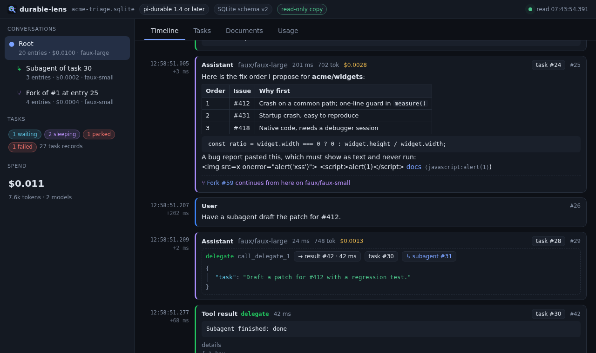
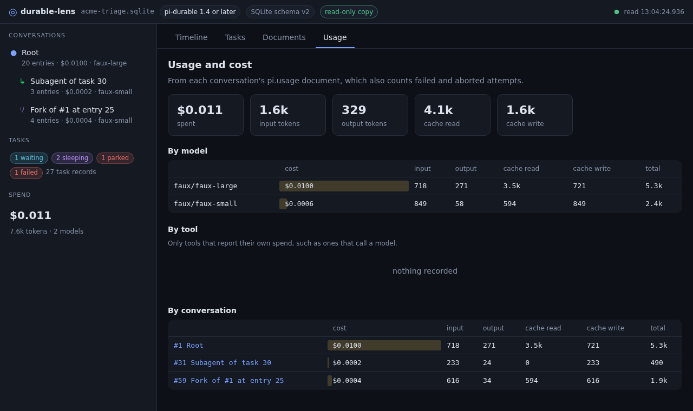

<p align="center">
  <picture>
    <source media="(prefers-color-scheme: dark)" srcset="docs/media/logo-dark.svg">
    
  </picture>
</p>

<p align="center">
  A local, read-only inspector for <a href="https://github.com/earendil-works/pi/tree/main/packages/durable">pi-durable</a> storage.
</p>

<p align="center">
  <a href="https://github.com/dggc/durable-lens/actions/workflows/ci.yml"></a>
  <a href="https://github.com/dggc/durable-lens/actions/workflows/codeql.yml"></a>
  <a href="https://scorecard.dev/viewer/?uri=github.com/dggc/durable-lens"></a>
  <a href="LICENSE"></a>
  
</p>

Point durable-lens at the SQLite file or JSONL directory of a pi-durable harness, running or not. It shows the transcript, the task graph, the documents, and what every turn cost and how long it took, on one timeline. It never runs your harness and never writes to your store, so you can point it at one a live process owns.


## Quick start

durable-lens needs Node.js 22.13 or later. It has no runtime dependencies. The package is not on npm yet, so run it from a clone:

```sh
git clone https://github.com/dggc/durable-lens.git
cd durable-lens
npm ci && npm run build
node dist/cli.js fixtures/stores/1.4.0/sqlite/session.sqlite --restart-limit 3 --open
```

That opens a store that a real pi-durable 1.4.0 wrote, which the repository includes. `--restart-limit 3` is the limit its scenario used, so that its parked task shows as parked. durable-lens prints a local address with a random token and keeps running until you press Ctrl-C:

```
durable-lens: pi-durable 1.4 or later, 3 conversations, 27 tasks
  http://127.0.0.1:38135/lT-dAgpmrBe1XrmFtxZUHHz6/
  read-only; Ctrl-C to stop
```

Open that address in a browser if `--open` did not. Then point it at your own store:

```sh
node dist/cli.js ./session.sqlite        # or a JSONL storage directory
```

The store is the path your harness passes to `openNodeSqliteStorage(path)` or `openNodeJsonlStorage(path)`. A SQLite store is a file. A JSONL store is a directory that contains `main.jsonl`.

Once the package is published, `npx durable-lens ./session.sqlite` will work too.


## What it shows

- **Timeline.** Every entry in order, with its time and the gap since the one before. Assistant turns show model, latency, tokens and cost; thinking is collapsed. Tool calls link to their results, their tasks and the subagent conversations they started. A strip above shows each generation and tool call as a bar on the same clock.
- **Task graph.** Every task with its owner edges: `waiting` on which tasks and with which policy, `sleeping` until when, `pending` after a crash, **parked** after crashing `restartLimit` times in a row, and the outcome and error of finished ones. Input, checkpoint and outcome are one click away.
- **Documents.** pi-durable's own (`pi.agent`, `pi.usage`, `pi.inbox`, ...) and yours, materialized from their stored bases and deltas. Rewindable documents get a slider that steps back through their revisions.
- **Usage.** Cost and tokens by model, by tool and by conversation, from each conversation's `pi.usage`, which also counts failed and aborted attempts.
- **Forks side by side.** A fork shows where it branched and what it inherited; *compare branches* puts the parent's continuation and the fork's next to each other.

The page follows the store: when the files change, it rereads them.

| Timeline | Transcript |
|---|---|
|  |  |
| **Task graph** | **Documents** |
|  |  |
| **Fork comparison** | **Usage** |
|  |  |

## Safe on a live store

durable-lens opens nothing of yours for writing. That takes more care than a read-only flag:

| Way to open | Writes beside the store? | Sees the latest commits? |
|---|---|---|
| SQLite, `readOnly: true` or `mode=ro` | yes: creates `-wal` and `-shm` on an idle database, rewrites `-shm` on a live one | yes |
| SQLite, `immutable=1` | no | **no**: skips the WAL, so a crashed or running store looks stale |
| pi-durable's storage with `HarnessOptions.readOnly` (main) | yes: migrates a schema v1 database to v2, checkpoints the WAL into the database file, truncates a torn JSONL line | yes |
| durable-lens | **no** | **yes** |

For SQLite, durable-lens copies the database and its WAL into a private temporary directory (a reflink where the filesystem has them) and opens the copy. The copy is accepted when the WAL header is the same before and after it, since a WAL reset in between could tear the copy, and, if there is no WAL with frames, the database's size and mtime are the same too; otherwise it copies again. For JSONL it reads the files, skips a last line still being appended, and reads again if the owner reclaimed a sidecar in between. It takes no locks, so it never slows the owner's checkpoints. The copy is a full copy of your transcripts: it lives in a directory only you can read, is deleted after each read, on exit and on Ctrl-C, and a later run deletes copies a killed process left behind.

The tests hash every file of every fixture before and after reading it, also while a pi-durable process holds the store open, and read 25 times while an owner commits every few milliseconds. See [Reading pi-durable storage](docs/reading-pi-durable-storage.md) for the measurements.

This matters most for an older store. A pi-durable 1.2.0 database (schema v1) opened once by 1.4.0 code is migrated to v2 for good, and 1.3.0 or earlier can no longer open it.

## Supported versions

| pi-durable | SQLite | JSONL |
|---|---|---|
| 1.2.0 | schema v1 | format 1 |
| 1.3.0 | schema v1 | format 1 |
| 1.4.0 | schema v2 (`sleeping` tasks, restart counts) | format 1 |
| main (36be9c6, 2026-10-23) | schema v2 | format 1 |

Each cell is a committed fixture, generated by the real release with pi-ai's faux provider (no model calls), in two states: closed cleanly, and right after the owner crashed (for SQLite, with its WAL still live). The header of the page names the release range that could have written the store, from the schema version and record shapes, such as *pi-durable 1.2–1.3*. Fields and kinds it does not know are shown as JSON rather than dropped. Table prefixes (pi-durable 1.3.0 and later) are tested with stores that the tests write themselves.

CI runs the tests on Linux and macOS.

## Encrypted stores

If your SQLite adapter encrypts or compresses payloads at rest, durable-lens sees only ciphertext, and says so. Give it a decoder:

```sh
DURABLE_LENS_KEY=... node dist/cli.js ./app.sqlite --decoder ./my-decoder.mjs
```

```js
// my-decoder.mjs: called for every stored JSON payload (records and document revisions)
export default function decode(value, site) {
  // site = { store: "sqlite" | "jsonl", table, column }
  return isMyEnvelope(value) ? JSON.parse(decrypt(value)) : value;
}
```

The decoder runs in the durable-lens process and reads its own keys; durable-lens never handles them. [examples/decoder-aes-gcm.mjs](examples/decoder-aes-gcm.mjs) decodes an AES-256-GCM envelope, and the tests run it against an encrypted copy of a fixture. See [Decoders](docs/decoders.md).

## Untrusted content

Transcripts carry prompts, tool output and whatever a model wrote. The page puts all of it on screen as text: Markdown is rendered by a small renderer that builds DOM nodes, raw HTML stays literal, and links show their target without becoming clickable. The server:

- listens on 127.0.0.1 only;
- serves everything under a random token;
- rejects requests whose `Host` is not its own (DNS rebinding);
- answers only GET and HEAD;
- sends a Content-Security-Policy that allows nothing but its own scripts and styles.

Nothing is fetched from anywhere else, and durable-lens sends no telemetry. `--open` hands the browser a link that works once and redirects to the tokened URL, because command lines are visible to other users of the machine. A decoder module is code that you choose to run, and it is outside this model. The full list of threats and mitigations is in the [security model](docs/security-model.md).

## CLI reference

```
durable-lens: a read-only inspector for pi-durable storage

Usage: durable-lens <store> [options]

  <store>               a SQLite file, or a JSONL storage directory (the one with main.jsonl)

Options:
  -p, --port <n>        port on 127.0.0.1 (default: a free one)
      --open            open the page in your browser
      --json            print the store as JSON and exit, without a server
      --decoder <file>  module whose default export decodes payloads an adapter encrypted or compressed
      --prefix <p>      SQLite table prefix, when several storages share one database
      --restart-limit <n>
                        the host's settings.restartLimit, to mark parked tasks (default 5)
      --no-watch        read once; do not follow changes
  -v, --version
  -h, --help

durable-lens never opens your store for writing. SQLite is read from a private copy of the database and its WAL, and
JSONL files are only read, so it is safe to point at a store a running harness owns.
```

Exit codes and examples are in the [CLI reference](docs/cli.md).

## JSON output and library

`--json` prints the same normalized view the page uses, for scripts and diffs. It contains your transcripts, so treat it like the store itself. The shape is described in [JSON output](docs/json-output.md) and may change before 1.0.

As a library, `openLens(path)` returns that view and `readStore(path)` returns the raw records. From a clone, import `/path/to/durable-lens/dist/index.js`. The package name works once it is published:

```js
import { openLens } from "durable-lens"; // from a clone: "/path/to/durable-lens/dist/index.js"

const lens = await openLens("./session.sqlite");
console.log(lens.format.version, lens.usage.total.cost);
```

See [Library](docs/library.md) for every export.

## Limits

- Reads the whole store into memory and copies a SQLite store on each change. Fine for development sessions; very large stores will be slow.
- SQLite and JSONL only. IndexedDB, Cloudflare Durable Object, Postgres and CouchDB stores are not read.
- Rewinding a document steps through its last 100 revisions (fewer when they add up to more than 4 MB).
- Whether a pending task is blocked by a missing definition depends on the host's registry, which the store does not record.
- Parked tasks are marked from `restarts` and `--restart-limit`, since the store does not record the host's limit.
- A decoder can only turn a stored JSON payload into other JSON. An adapter that stores raw binary instead of JSON text is not supported.

## Roadmap

[VISION.md](VISION.md) states what the project is for, what it will not do, and what is planned next. Plans are not promises.

## Documentation

| Page | Content |
|---|---|
| [docs/README.md](docs/README.md) | Index of the documentation |
| [docs/architecture.md](docs/architecture.md) | Data flow, modules, snapshots, watching |
| [docs/security-model.md](docs/security-model.md) | Threats and mitigations |
| [docs/cli.md](docs/cli.md) | Every option, exit codes, examples |
| [docs/json-output.md](docs/json-output.md) | The `--json` shape, field by field |
| [docs/library.md](docs/library.md) | The exports of the package |
| [docs/decoders.md](docs/decoders.md) | Reading encrypted or compressed stores |
| [docs/troubleshooting.md](docs/troubleshooting.md) | Error and warning messages |
| [docs/reading-pi-durable-storage.md](docs/reading-pi-durable-storage.md) | How a store is read without writing to it, with measurements |
| [docs/releasing.md](docs/releasing.md) | How a release is made |
| [CHANGELOG.md](CHANGELOG.md) | What changed in each release |

## Contributing and security

Bug reports, fixtures for new pi-durable releases and pull requests are welcome. Read [CONTRIBUTING.md](CONTRIBUTING.md) first. Never attach a real store, transcript or `--json` output to an issue or pull request.

To report a vulnerability, use [private vulnerability reporting](https://github.com/dggc/durable-lens/security/advisories/new) and read [SECURITY.md](SECURITY.md). Everyone taking part is expected to follow the [code of conduct](CODE_OF_CONDUCT.md).

durable-lens is not affiliated with Earendil. It was written with AI coding agents (Claude Code) and is tested against the pi-durable releases above.

## License

[MIT](LICENSE)
